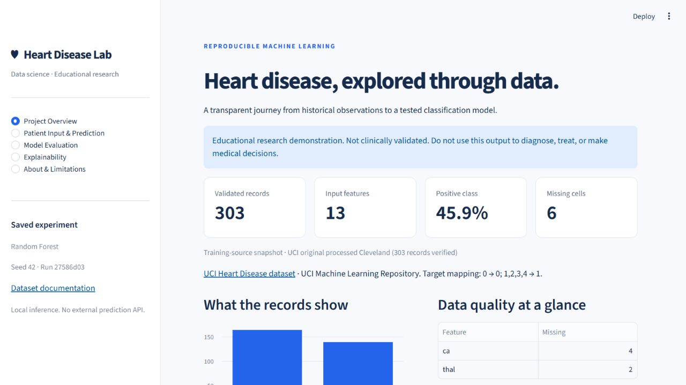

# Heart Disease Lab

A complete local machine learning project using **real UCI Heart Disease records**: validated acquisition, exploratory analysis, leakage-safe model comparison, reusable inference and a five-page Streamlit dashboard.

Release 1.2.1 adds a standard `uv.lock`, enforced lint/format/type/coverage checks,
dependency auditing and updates, JSON logging, and isolated development/serving
containers. It retains the [portable release](docs/deployment.md), MIT code
license, public-example-only cloud entrypoint and transfer-gap diagnostics.
Raw datasets, local run snapshots and model binaries remain outside Git history.
The fitted model and its probability method have not been changed.

**Educational use only. Not clinically validated. Do not use the model, probability output or dashboard to diagnose, treat or make medical decisions.**

## Overview and objectives

The task is supervised binary classification of the **recorded angiographic disease-status label**, not prediction of future disease onset. The project demonstrates practical data validation, preprocessing, honest evaluation and software engineering for a student portfolio or interview.

- Official UCI download with an official-archive fallback and manual-file support.
- Explicit original-code and string-coded Kaggle-mirror loaders, with provenance and checksums.
- Computed EDA reports and six chart groups; runnable Python script and notebook.
- Logistic Regression, Random Forest and XGBoost with fold-local preprocessing.
- Three repeats of training-only stratified CV, nested probability-method checks and a clearly labelled historical holdout audit.
- Six classification metrics, class-wise errors, ROC curves and original-feature permutation importance.
- Persisted complete pipeline, versioned metadata and validated local inference.
- Native Streamlit forms, source audit trail, comparison download and graceful missing-file states.
- Unit tests, UI recovery tests and reproducible environment snapshot.
- Wilson/bootstrap intervals, recorded-sex/age subgroup slices and an audited separate-site Hungarian evaluation.
- Public-example/reset controls, minimal result downloads, versioned experiments, a model card and GitHub Actions checks.

## Reproducible development — Windows, macOS and Linux

Install [uv](https://docs.astral.sh/uv/getting-started/installation/), clone this
repository, and run these commands from its root:

```sh
uv sync --locked --extra dev --python 3.13
uv run --locked pytest --cov
uv run --locked ruff check src scripts app.py tests deploy
uv run --locked ruff format --check src scripts app.py tests deploy
uv run --locked mypy src
uv run --locked streamlit run deploy/streamlit_app.py
```

The last command runs the pinned public-example demo without downloading the
full datasets or training a model. For local training, use the acquisition and
training commands below. The universal lockfile includes Python/platform markers
and package hashes; CI checks Python 3.10 and 3.13 on Windows and Linux.
`pyproject.toml` is the dependency source of truth. Requirements files are generated
exports. See [CONTRIBUTING.md](CONTRIBUTING.md) for lock updates and all checks.

For an isolated test suite or demo, follow [the container guide](docs/containers.md).
`docker compose up --build` serves public examples on localhost port 8502.
The native Streamlit `/_stcore/health` endpoint is checked separately from model
and dashboard readiness.

## Pip quick start — Windows PowerShell

From the project directory, Python **3.10+** is required. This workspace was verified with Python 3.13 on Windows; use a recent Python release with binary wheels for all dependencies.

```powershell
python -m venv .venv
.\.venv\Scripts\Activate.ps1
python -m pip install --upgrade pip
python -m pip install --require-hashes -r requirements-lock.txt
python -m pip install -e . --no-deps
python scripts/download_data.py
python scripts/download_external.py
python scripts/eda.py
python scripts/train.py --external data/raw/processed.hungarian.data
python scripts/predict.py
python -m pytest -q
python -m streamlit run app.py
```

If execution policy prevents activation, use the virtual environment's interpreter directly; changing machine-wide policy is unnecessary:

```powershell
.\.venv\Scripts\python.exe -m pip install --require-hashes -r requirements-lock.txt
.\.venv\Scripts\python.exe -m pip install -e . --no-deps
.\.venv\Scripts\python.exe scripts/download_data.py
.\.venv\Scripts\python.exe scripts/download_external.py
.\.venv\Scripts\python.exe scripts/train.py --external data/raw/processed.hungarian.data
.\.venv\Scripts\python.exe -m pytest -q
.\.venv\Scripts\python.exe -m streamlit run app.py
```

## macOS / Linux

```bash
python3 -m venv .venv
source .venv/bin/activate
python -m pip install --upgrade pip
python -m pip install --require-hashes -r requirements-lock.txt
python -m pip install -e . --no-deps
python scripts/download_data.py
python scripts/download_external.py
python scripts/eda.py
python scripts/train.py --external data/raw/processed.hungarian.data
python scripts/predict.py
python -m pytest -q
python -m streamlit run app.py
```

Open [the local dashboard](http://localhost:8501). The provided configuration binds to localhost, disables Streamlit usage telemetry and uses a light navy/blue theme. No credentials, Kaggle account or paid services are required.

`scripts/train.py` also generates EDA, so a separate EDA run is optional.
`requirements-lock.txt` is the fully hashed development export of `uv.lock`,
including tests and quality tools; `requirements.txt` is the runtime-only export.
Both include platform and Python markers. Install the local project separately
with `python -m pip install -e . --no-deps` after installing the locked packages.

## Dataset and attribution

Default source: [UCI Heart Disease](https://archive.ics.uci.edu/dataset/45/heart+disease), original **processed Cleveland** subset. The loader requests the [traditional headerless file](https://archive.ics.uci.edu/ml/machine-learning-databases/heart-disease/processed.cleveland.data), then tries the official dataset ZIP if needed. Downloads are validated before creating the destination. Existing files are validated and preserved without requesting the network.

Attribution: Janosi, A., Steinbrunn, W., Pfisterer, M., & Detrano, R. (1989). *Heart Disease* [Dataset]. UCI Machine Learning Repository. [DOI: 10.24432/C52P4X](https://doi.org/10.24432/C52P4X). Dataset license: CC BY 4.0.

The default file was actually retrieved and verified at 303 rows, 13 predictors and a target. `reports/data_provenance.json` records actual source URL, raw/selected/retained shape, SHA-256, original labels, mapping, missingness, observed ranges and removals. A different local file is not described as the verified original merely because it contains 303 rows.

The independent-site check uses the official `processed.hungarian.data`: 294 source rows, one recorded exact duplicate removed, 293 retained in the verified run. It is never pooled with Cleveland or used for fitting/calibration/model selection. `reports/external_evaluation.json` records the source hash, all exclusions, feature-overlap audit, missingness, range shifts, metrics, intervals and demographic slices. Invalid rows stop the external evaluation instead of being silently corrected or dropped. Missing values use the frozen Cleveland-trained imputers. Very high missingness makes this a limited historical transfer check, not clinical validation.

Raw/processed datasets and model binaries are ignored by Git. Small aggregate reports and figures are retained for portfolio review. Do not commit patient input, raw records or private local sources. The notebook is distributed without saved cell outputs.

### Manual download and compatible CSVs

If network access is restricted, download `processed.cleveland.data` from UCI and put it in `data/raw/processed.cleveland.data`. Run training normally. No fabricated or synthetic fallback data exists.

Original-code headerless files require exactly 14 fields in the order below; named CSVs require the same 13 predictors plus exactly one target. Column names are trimmed and case-normalized. Positional interpretation is used only for the explicitly documented headerless layout.

```powershell
python scripts/train.py --data "data/raw/my_cleveland.csv" --schema uci
```

`num` asserts the original UCI 0–4 diagnosis semantics. `target` and `HeartDisease` require an explicit assertion after checking the source documentation:

```powershell
python scripts/train.py --data "data/raw/verified_binary.csv" --target-semantics binary
```

`binary` means **0=absence, 1=presence**; this is never inferred from value counts. Use `--target-semantics uci` for a renamed 0–4 UCI diagnosis field. Some internet `heart.csv` files reverse targets or recode categories; do not pass these flags without verifying their meanings.

The [redwankarimsony Kaggle mirror](https://www.kaggle.com/datasets/redwankarimsony/heart-disease-data) uses a `dataset` site column, named categories, `thalch` and `num`. Download its CSV manually, then select one site explicitly (Cleveland by default):

```powershell
python scripts/eda.py --data "data/raw/heart_disease_uci.csv" --schema kaggle --site Cleveland
python scripts/train.py --data "data/raw/heart_disease_uci.csv" --schema kaggle --site Cleveland
```

This mode drops only documented `id` and `dataset` metadata, renames `thalch`, maps documented strings back to original UCI codes, and records how many other-site rows were excluded. Sites are never silently pooled. It does not accept arbitrary zero-indexed numeric recodings. Other sites can contain zero placeholders, entirely missing features or unsupported codes; validation stops with an explanation rather than inventing corrections. To support a new variant, add and document its semantics first.

Both EDA and training accept `--data`, `--schema`, `--site`, `--target-semantics` and `--reports`. Training additionally accepts `--model` and `--test-size`. Run a script with `--help` for details. Raw-data errors identify fields or malformed rows; nothing suspicious is silently skipped.

Training also accepts `--external PATH`, `--cv-repeats` (default 3), `--bootstrap-resamples` (default 1000, minimum 100), `--runs-dir`, and `--no-activate`. An absent or incompatible external file is reported as unavailable; no substitute is used. No network is required by training itself.

## Canonical schema

Headerless order: `age,sex,cp,trestbps,chol,fbs,restecg,thalach,exang,oldpeak,slope,ca,thal,num`.

| Field | Meaning and canonical values | Modeling |
|---|---|---|
| age | Whole years; entry bounds 1–120 | Numeric |
| sex | Source codes: 0 female, 1 male; limited demographic representation | Categorical |
| cp | 1 typical angina, 2 atypical angina, 3 non-anginal pain, 4 asymptomatic | Categorical |
| trestbps | Resting BP, mm Hg; whole number 50–300 | Numeric |
| chol | Serum cholesterol, mg/dL; whole number 50–800 | Numeric |
| fbs | Fasting blood sugar >120 mg/dL: 0 false, 1 true | Categorical |
| restecg | 0 normal, 1 ST–T abnormality, 2 LV hypertrophy | Categorical |
| thalach | Maximum achieved heart rate, bpm; whole number 20–250 | Numeric |
| exang | Exercise-induced angina: 0 no, 1 yes | Categorical |
| oldpeak | Exercise ST depression relative to rest; entry bounds −5–10 | Numeric |
| slope | 1 upsloping, 2 flat, 3 downsloping | Categorical |
| ca | Major vessels (0–3) seen by fluoroscopy | Categorical |
| thal | 3 normal, 6 fixed defect, 7 reversible defect | Categorical |
| num / target | Source 0 → binary 0; source 1–4 → binary 1 | Target only |

The numeric bounds are **broad data-entry constraints, not medically validated normal ranges**. The app also warns when a valid numeric input is outside the observed training range. Training accepts known missing feature markers (`?`, blanks, NA, N/A, NaN, null); inference requires all 13 valid fields. Invalid numbers, infinite values, unexpected targets, duplicate column names and extra columns are rejected.

Exact duplicate normalized records are removed **before splitting**, with counts and warnings. Identical predictors with conflicting labels cause an error. Missing targets, entirely missing features and inadequate class counts stop training. Feature leakage is prevented by passing only the explicit predictor list to the pipelines.

## Architecture and technologies

```text
.
├── app.py                         # Streamlit: five views, blank input form
├── requirements.txt               # Portable compatible dependency ranges
├── requirements-lock.txt          # Tested environment snapshot
├── pyproject.toml                 # Editable package and pytest configuration
├── .streamlit/config.toml         # Local server, light theme, no telemetry
├── data/{raw,processed}/          # Ignored records; reproducible sources
├── models/                        # Ignored pipeline and metadata
├── reports/
│   ├── data_provenance.json
│   ├── eda_summary.json / eda_report.md
│   ├── descriptive_statistics.csv
│   ├── model_comparison.csv
│   ├── evaluation_report.json
│   ├── explainability.json / permutation_importance.csv
│   ├── transformed_model_weights.csv / roc_curves.json
│   ├── project_report.md
│   ├── model_card.md / calibration_report.json / external_evaluation.json
│   ├── calibration_comparison.csv / cv_repeat_summary.csv
│   ├── subgroup_evaluation.csv / external_subgroups.csv
│   └── figures/                   # Real-data EDA and diagnostic plots
├── notebooks/01_exploratory_data_analysis.ipynb
├── scripts/{download_data,download_external,eda,train,predict,verify_run,build_demo}.py
├── src/heart_disease/
│   ├── config.py / io.py / data.py
│   ├── eda.py / preprocessing.py
│   ├── modeling.py / evaluation.py / explainability.py
│   └── prediction.py
│   # Also: research.py, external.py, experiments.py and demo.py
├── experiments/runs/              # Timestamped complete runs; model binaries ignored
├── .github/workflows/             # Unit/UI matrix and manual real-data integration
├── docs/architecture.md           # Mermaid diagram and evaluation boundaries
├── docs/demo.mp4                  # Captioned walkthrough of actual app screenshots
└── tests/                         # Isolated validation, model, inference and UI tests
```

Python, NumPy, pandas, Matplotlib, Seaborn, scikit-learn, XGBoost, joblib, Streamlit and pytest. No database, external inference API, SMOTE or heavyweight explainability framework.

The EDA notebook runs the shared analysis functions and displays samples, statistics, quality summaries and figures. To use it interactively, optionally install `jupyterlab` and `ipykernel`, then open it with your project environment. The fully supported alternative, `python scripts/eda.py`, needs no notebook packages.

## Evaluation methodology

1. Validate one real source and remove recorded exact duplicates.
2. Split with stratification, test proportion 20%, seed 42. The verified default split has 242 training and 61 test observations.
3. Use three repeats of up to five shuffled stratified folds in training; adapt to the smallest training-class count, or stop when fewer than two folds are possible. Both test classes are required. A different test fraction must be chosen explicitly. All base models share identical splits. Per-repeat averages are saved separately.
4. Fit preprocessing independently inside each fold: numeric median imputation, scaling for Logistic Regression, categorical mode imputation and `OneHotEncoder(handle_unknown="ignore")`. Vessel count is categorical to avoid assuming a linear effect. No full-data imputation, feature selection or engineered clinical score.
5. Compare fixed regularized models: Logistic Regression (`C=1`, 2,000 max iterations), Random Forest (250 trees, depth 6, leaf size 3), XGBoost (180 trees, depth 2, learning rate .04, L1/L2 regularization). Exact settings are in the evaluation JSON.
6. Select highest repeated-CV mean ROC-AUC, breaking ties by recall, precision, then name. Compare raw and sigmoid probability methods on the same outer training folds; sigmoid uses up to three **inner** calibration folds, with the entire preprocessing/model pipeline inside every inner fold. Retain sigmoid only if mean Brier improves by at least 0.002 and mean log loss also decreases. This is a predeclared conservative software rule, not a significance test or clinical criterion. Isotonic is omitted because the calibration samples are small.
7. Freeze classifier, probability method and the 0.5 threshold before evaluating either cohort. Fit only on training. The saved pipeline may contain a calibrated ensemble of independently fitted training-fold pipelines. Other classifiers' audit results remain secondary descriptions.
8. Keep the previously inspected 61-record Cleveland holdout as a **historical audit**, not a fresh unbiased final benchmark. Evaluate the frozen selected pipeline on the separately sourced Hungarian cohort when explicitly supplied. Never tune against either viewed cohort.

Metrics: accuracy, precision, recall/sensitivity, F1, specificity and ROC-AUC. Confusion matrix order is `[[TN, FP], [FN, TP]]`; class-wise precision/recall/F1/support are saved. Undefined precision/recall/F1 uses `zero_division=0`. Undefined ROC-AUC is `null`, although the split checks prevent a single-class final test in the main experiment. CV standard deviations use population SD (`ddof=0`) across folds; they are **not confidence intervals**.

`reports/model_comparison.csv` includes actual CV means/SDs, final test metrics, availability and selected flags. `evaluation_report.json` includes fold scores, parameters, row indices and class counts. `project_report.md` explains the genuine result and errors. An unavailable XGBoost dependency/platform is explicitly reported; required baseline failures stop training. No hard-coded performance numbers are used in the app or plots.

Maximizing AUC does not establish clinical safety. Accuracy alone can conceal false negatives or imbalance. The Cleveland holdout was viewed in the original experiment, so later results are explicitly an audit. The Hungarian evaluation is a historical site-transfer check with substantial missingness; no prospective or clinical validation exists.

Wilson 95% intervals accompany accuracy, precision, recall and specificity. ROC-AUC uses a seeded, class-stratified percentile bootstrap (1000 resamples), conditional on the fixed model and observed class counts. These intervals omit training/selection and site uncertainty. Repeated CV folds are correlated: their SDs and per-repeat averages are descriptive, not independent-sample confidence intervals. Undefined subgroup denominators remain null, unlike aggregate classification-report metrics that use explicit zero-division handling.

Probability quality includes Brier score, log loss and reliability diagrams. Brier/log loss mix calibration, discrimination and uncertainty; neither isolates calibration. Training reliability curves use the per-observation average of repeated out-of-fold predictions, not repeated copies of each observation; they describe CV ensemble predictions. Bin intervals remain descriptive because model-training dependence is not captured. The selected classifier's CV classification columns describe its raw base estimator; its audit/external metrics use the retained probability method, explicitly labelled.

Predeclared demographic slices use recorded sex and ages under 50, 50–59 and 60+. Reports include total/positive/negative counts, metrics, Wilson intervals, undefined values and small-group cautions. No fairness, equivalence or clinical-safety conclusion is drawn.

## Explainability and inference

Held-out permutation importance shuffles each **original input column**, measuring ROC-AUC decrease over 20 repeats. It includes the entire preprocessing pipeline. Correlated features may share importance; negative estimates are possible, and shuffle SD is not population uncertainty. This held-out diagnostic must not guide tuning or model reselection. Supplementary transformed coefficients/native weights are separately labelled. Associations do not imply causation or clinical importance.

Saved paths:

- `models/heart_model.joblib`: fitted preprocessing plus selected classifier.
- `models/heart_model.metadata.json`: checksum, source, schema, target semantics, selected model, train configuration, versions, input bounds and test summary.
- `reports/`: computed EDA, model comparison, full evaluation, explainability, plots and project report.

Reusable batch API (after editable installation):

```python
from heart_disease.config import FEATURES
from heart_disease.data import load_dataset
from heart_disease.prediction import load_artifact, predict_records

pipeline, metadata = load_artifact()
# Functional demonstration on actual complete source records; not an evaluation.
records = load_dataset().frame[FEATURES].dropna().head(2)
result = predict_records(pipeline, records)
print(result)  # prediction, positive_class_probability
```

The model-estimated positive-class probability uses the saved `raw` or training-validated `sigmoid` method. The verified upgrade retained **raw** because sigmoid did not pass the predeclared improvement threshold. Neither method yields a clinically validated probability of disease or a medical risk score. The output cannot confirm or rule out a condition.

**Trust:** joblib deserialization can execute code. Load only artifacts created by you or from a trusted source. The stored SHA-256 detects damage or mismatched metadata; it does not authenticate an untrusted artifact. Loading checks schema and dependency major/minor compatibility before deserialization. Use the tested lock file or retrain when versions change.

Default paths resolve relative to this project, independent of the shell directory. Optional `HEART_DATA_PATH`, `HEART_MODEL_PATH` and `HEART_REPORT_DIR` environment variables configure paths. If using `--model` or `--reports`, configure the same locations before launching the app; model/report run IDs must match.

Every training command creates `experiments/runs/<UTC timestamp>-<id>/{models,reports}/` and a completion manifest. The original active experiment is preserved before the first upgrade; existing complete snapshots are reused. A complete run records model/report checksums and is then copied to stable active paths (`models/`, `reports/`). Failed/partial runs do not replace active results. `--no-activate` saves a separate completed run without updating the UI. No script modifies a completed snapshot. Preserve the versioned folders locally; raw records and model binaries remain ignored by Git. The downloader never overwrites existing data. See [the architecture diagram](docs/architecture.md).

## Dashboard and screenshots



Screenshots from the verified local application are included in `docs/screenshots/overview.png` and `docs/screenshots/evaluation.png`.

[Watch the 26-second captioned walkthrough](docs/demo.mp4). It is assembled from actual local application screenshots, without narration; it is not presented as a live screen recording. To rebuild after capturing the six documented views:

```powershell
python -m pip install -r requirements-demo.txt
python scripts/build_demo.py
```

1. **Project Overview:** actual source snapshot, class distribution, missingness, workflow and EDA.
2. **Patient Input & Prediction:** blank inputs, a clearly labelled public UCI example loader, reset control, validation, local inference and an optional output-only JSON download. Manual/private sources are never presented as public examples. Source hashes are checked before loading examples.
3. **Model Evaluation:** selected model, six Cleveland audit metrics, repeated CV, interval chart, calibration comparison/reliability diagrams, subgroup slices and external-site results with an explicit missingness audit.
4. **Explainability:** original-feature permutation ranking, variability and interpretation limits.
5. **About & Limitations:** attribution, architecture, bias, reproducibility, privacy and artifact trust.

To create portfolio screenshots, launch Streamlit, open each page at a typical laptop width, and use the browser or Windows screenshot tool. Save to a chosen `docs/screenshots/` folder. Use public dataset examples and avoid identifiable patient information. Do not present blank/example form values as a real patient's record. The dashboard stores no input history or database records; Streamlit temporarily retains form values in the browser session. Do not expose this demo publicly with sensitive information.

## Tests and verification

```powershell
python -m pytest -q
python -m compileall -q src scripts app.py tests
python -m pip check
python scripts/predict.py
python scripts/verify_run.py
```

Tests cover parsing, targets and semantics, invalid schemas/values, missing markers, duplicates, mirror mappings/site isolation, network failure and existing-file preservation, preprocessing leakage, unknown encoder categories, disjoint reproducible splits/adaptive folds, real estimator fitting on isolated fixtures, metric semantics, strict inference, persistence consistency, corrupt/incompatible artifacts and all five missing-artifact UI states. Artificial fixtures are used **only in isolated tests**, never as real training/evaluation records or fallback predictions. Real-data training results come exclusively from the downloaded file.

After startup, `http://127.0.0.1:8501/_stcore/health` should return `ok`. Use Streamlit AppTest for navigation/form verification; a server health check alone does not verify prediction behavior.

`python scripts/verify_run.py --server-url http://127.0.0.1:8501` verifies the real-data source checksum, saved model's holdout metrics, CV winner, report files, all populated pages, blank-input rejection and form/API prediction consistency on a public source record. It also checks the running server when `--server-url` is supplied. This is a consistency check; it never tunes or reselects models.

The extended check also verifies repeated-CV/calibration coherence, public-example/reset controls, output downloads that exclude the input measurements, and reproducibility of external metrics when available. Unit tests cover Wilson boundaries, deterministic bootstrap intervals, nested calibrator placement, calibrated artifact persistence, undefined/empty demographic slices, external no-fit behavior, overlap exclusion, and versioned snapshot/publish behavior.

Add `--require-external` to fail verification unless the external cohort was actually evaluated; the real-data CI workflow uses this flag.

## Continuous integration and portfolio materials

`.github/workflows/ci.yml` runs the locked Windows/Linux Python 3.10/3.13 test
matrix, enforces 85% combined application/package statement-and-branch coverage,
checks Ruff lint/format and mypy, audits pinned dependencies, builds distributions
and verifies isolated test/serving containers. Dependabot proposes weekly uv,
GitHub Actions and Docker updates. The current Windows run passed **88 tests**
with **86.57%** combined coverage (89.67% statements, 76.14% branches), without
coverage exclusions. Six third-party Seaborn/Matplotlib deprecation warnings
remain visible; they are not suppressed or reported as failures.

The manual real-data integration workflow downloads both official cohorts,
trains the pipeline and verifies reports/UI consistency. It retains aggregate
reports only. The initial [test matrix](https://github.com/deleted04user/heart-disease-lab/actions/runs/39279288108),
[real-data integration](https://github.com/deleted04user/heart-disease-lab/actions/runs/39279123927)
and [portable verification](https://github.com/deleted04user/heart-disease-lab/actions/runs/39279195691)
completed successfully. Current run results are in [Actions](https://github.com/deleted04user/heart-disease-lab/actions).
See [engineering verification](reports/engineering_verification.json) and
[contribution instructions](CONTRIBUTING.md) for the exact checks.

The computed [model card](reports/model_card.md) documents intended use, training, selection, calibration, intervals, separate-site results and limitations. [Architecture](docs/architecture.md), real screenshots and the captioned MP4 support portfolio demonstrations. Raw data, model binaries and user input measurements are excluded from uploaded CI artifacts. Do not mistake automatic checks or a model card for clinical approval.

## Portable release and cloud demo

```powershell
python scripts/build_release.py
python scripts/verify_release.py
```

The ZIP in `dist/` contains the trusted fitted pipeline, matching metadata, aggregate reports with workstation paths removed, code, attribution and five public UCI examples. It works from a separate directory without original raw data or an editable package installation. Runtime requirements are pinned to the model's versions; XGBoost/training/testing packages are not needed to serve the selected Random Forest.

The cloud entrypoint is `deploy/streamlit_app.py`. It downloads only the committed, SHA-pinned GitHub release asset, validates the archive and its file hashes, configures portable paths and enables `HEART_PUBLIC_DEMO=1`. The hosted form disables personal measurement entry and rejects values differing from the selected bundled public example on the server. No model training occurs at startup. A missing or damaged release shows an explicit error instead of fake predictions.

Keep the local `main` branch's localhost binding. The dedicated `streamlit-demo` branch changes only the server binding for the hosted service. Deployment instructions, versioning, account prerequisites and verification commands are in [docs/deployment.md](docs/deployment.md). A live deployment is not claimed merely because release files exist.

`.github/workflows/portable-release.yml` performs a separate clean Linux verification using serving dependencies only and the published archive. It exercises every page and bundled examples without the raw data. Local verification JSONs record their actual OS, Python, archive hash and checked behaviors.

The actual cloud entrypoint also passed locally from a fresh Linux clone of the public `streamlit-demo` branch: it downloaded the published pinned asset, opened all five pages, disabled personal inputs and predicted two bundled examples. Public hosting is deferred at the maintainer's request. It will require Streamlit account sign-in and Terms acceptance; no working public app URL has been issued yet.

## Investigating the external recall gap

```powershell
python scripts/investigate_transfer.py
python scripts/reserve_cohort.py
```

The investigation combines already-viewed Hungarian missingness/slices with controlled **training-only out-of-fold** feature-masking checks. These are perturbations of actual validation observations, not new natural cohorts or invented training records. The study preserves the deployed model, threshold and probability method and explicitly limits causal interpretation. See [the computed report](reports/transfer_diagnostics.md).

The [next experiment protocol](docs/next_experiment_protocol.md) declares fixed availability-focused candidates and training-only selection before the separate Long Beach VA file is fetched. The reservation helper records opaque byte and protocol hashes without parsing the file; ordinary loading rejects the reserved bytes, including renamed copies. Nothing is evaluated on the reserved file. Public source documentation is known; this is not a blinded prospective clinical trial. See [reservation transparency notes](docs/reservation_notes.md).

Before publishing source, `python scripts/audit_publication.py` checks the staged Git index for raw/reserved data, model binaries, run snapshots, credentials and workstation-specific personal paths. Code is MIT; UCI examples retain CC BY 4.0 attribution in [NOTICE.md](NOTICE.md).

## Troubleshooting and limitations

- **Network/SSL failures:** the error lists both official-source attempts. Use the manual download workflow; no credentials are needed. Keep TLS verification enabled.
- **Missing artifacts:** run training. The app shows recovery commands and never generates a fake prediction or metric.
- **Schema error:** inspect the specific field and encoding. Do not relabel zero-based categories or invert targets without source documentation. Zero measurement placeholders in non-Cleveland sources are not silently corrected.
- **Insufficient class counts:** add real records or explicitly choose a compatible `--test-size`; CV needs at least two training records per class and both test classes.
- **XGBoost installation/import failure:** try a supported 64-bit Python with available wheels and platform runtime dependencies. The project reports XGBoost as unavailable and permits the two baselines. No XGBoost result is fabricated. If your environment cannot install that package at all, install the other requirements first; XGBoost remains part of the declared full environment.
- **Version/checksum mismatch:** restore the matching trusted artifact and metadata or retrain. Do not bypass integrity checks.
- **Port in use:** `python -m streamlit run app.py --server.port 8502`.
- **Privacy:** this is a localhost demonstration, not an authenticated clinical system. No deployment, production readiness or medical approval is claimed.

Future work: additional untouched cohorts, prospective evaluation, measurement harmonization with source documentation, more representative demographic data and independently reviewed fairness studies. Existing viewed cohorts must not become tuning targets. These steps require suitable data and do not turn the current demo into a diagnostic system.

Reference documentation: [scikit-learn supervised learning](https://scikit-learn.org/stable/supervised_learning.html), [pipelines and leakage](https://scikit-learn.org/stable/common_pitfalls.html), [XGBoost parameters](https://xgboost.readthedocs.io/en/stable/parameter.html), [Streamlit](https://docs.streamlit.io/).

## Operational logging

The dashboard and download/training/EDA/prediction commands emit JSON operational
logs to stderr, with UTC timestamp, severity, logger name and message. Set
`HEART_LOG_LEVEL` to `DEBUG`, `INFO` (default), `WARNING`, `ERROR` or `CRITICAL`.
Streamlit reruns reuse the handler and preserve host logging handlers. Application
code must not log patient measurements. `.env.example` documents all supported
environment variables; export them in your shell because `.env` is not loaded
automatically.
