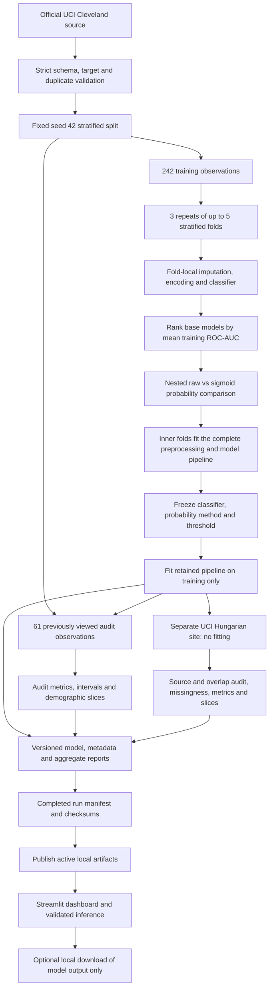

# Architecture and evaluation boundaries



The whole preprocessing pipeline sits **inside** each calibration fold. Nothing is fitted on Cleveland audit observations or on Hungarian observations. Classifier and probability selection never consume either cohort's metrics.

The Cleveland holdout was viewed in the original project and is explicitly an audit in later experiments. The historical external cohort is a site-transfer check, not clinical validation. Subgroup metrics are descriptive, particularly when counts are small.

Each training command creates a new `experiments/runs/<timestamp>-<id>/` folder. The first upgrade preserves the earlier active experiment. A completed run records model/report hashes and is then copied to the stable active paths used by the UI. `--no-activate` keeps the new run separate. Raw records, model binaries and clinical inputs are not included in CI artifacts; user input history is not stored.

Before activation, the snapshot verifier checks the exact report inventory,
every report/model checksum and the run, model, probability-method and source
identities in the manifest, metadata and evaluation report. New schema-2
manifests also pin the metadata bytes. Extra files, missing reports, symbolic
links and unsafe paths fail before any active file is changed. Activation
copies only manifest-listed reports and cannot target its own snapshot.
Completed manifests cannot be overwritten by `complete_run`.

```sh
python scripts/verify_experiment.py experiments/runs/<timestamp>-<id>
```

This command reads only the snapshot's manifest, metadata and reports and hashes
the model bytes. It makes no network requests, opens no source cohort and never
deserializes the model. Legacy manifests remain supported, with the missing
metadata digest explicitly reported. Checksums establish consistency within a
snapshot; trust still depends on its origin. For metric recomputation and UI
checks, use `scripts/verify_run.py` on the trusted active experiment.

JSON documents are serialized, written to a unique same-directory temporary
file, flushed and replaced atomically. A failed staged write preserves the
previous document and cleans up the temporary file. This guarantee applies to
each JSON file. Publishing the model and reports is not a multi-file transaction;
run one activation at a time and rerun it if an operating-system copy fails.
